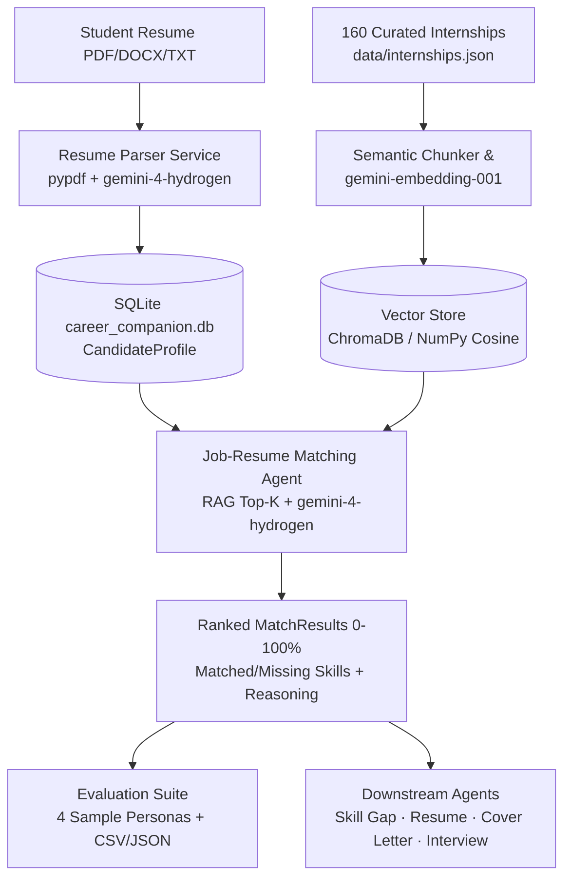

# AI Career Companion Agent for Internship Matching & Interview Preparation

**Infosys Springboard 7.0 Internship Project — Milestone 1 & Milestone 2 Complete Implementation**

A production-ready full-stack AI platform combining structured resume extraction, a 160-posting Indian tech-hub internship knowledge base, semantic RAG vector retrieval (`gemini-embedding-001`), an explainable Job-Resume Matching Agent (`gemini-4-hydrogen`), and an automated 4-persona evaluation benchmark.

---

## Project Structure

```text
├── app.py                        # 5-Tab Streamlit UI (Python runtime)
├── api.py                        # Optional FastAPI REST API wrapping modular services
├── server.ts                     # Express + Vite full-stack server (Live Web Preview)
├── models/
│   └── schemas.py                # Strict Pydantic v2 schemas (CandidateProfile, InternshipPosting, MatchResult)
├── services/
│   ├── database.py               # SQLite persistence (career_companion.db)
│   ├── resume_parser.py          # PDF/DOCX/TXT extractor + Gemini response_schema parser
│   ├── rag_pipeline.py           # Semantic chunking + gemini-embedding-001 + ChromaDB/NumPy vector index
│   ├── matching_agent.py         # Top-K RAG retrieval + Gemini structured 0-100 scoring agent
│   └── evaluation.py             # 4-persona Evaluation & Validation Suite (CSV/JSON reports)
├── scripts/
│   └── generate_dataset.py       # Deterministic generator for 160 deduplicated internship postings
├── data/
│   └── internships.json          # 160 curated Indian tech-hub internships
├── requirements.txt              # Python dependencies
└── README.md
```

---

## Quick Start (Python Streamlit)

```bash
# 1. Create and activate virtual environment
python -m venv .venv
source .venv/bin/activate  # Windows: .venv\Scripts\activate

# 2. Install dependencies
pip install -r requirements.txt

# 3. Configure Gemini API Key
export GEMINI_API_KEY="your_gemini_api_key_here"

# 4. (Optional) Regenerate 160 curated internship postings
python scripts/generate_dataset.py

# 5. Launch Streamlit application
streamlit run app.py

# Optional: Launch FastAPI backend
uvicorn api:app --reload --port 8000
```

---

## Multi-Agent System Architecture



---

## Milestone 1 & Milestone 2 Checklist

- [x] **M1.1** Multi-format resume ingestion (`PDF`, `DOCX`, `TXT`, or pasted text) with empty/corrupt file validation.
- [x] **M1.2** Strict `CandidateProfile` Pydantic schema extraction using `gemini-4-hydrogen` (`response_schema`).
- [x] **M1.3** Manual profile editing and SQLite persistence (`career_companion.db`).
- [x] **M2.1** Curated, deduplicated dataset of 160 internship postings across 7 domains and 5 Indian tech hubs (`Bengaluru`, `Hyderabad`, `Pune`, `Chennai`, `Remote`).
- [x] **M2.2** Semantic chunking, `gemini-embedding-001` vector generation, and persistent local vector index with progress feedback.
- [x] **M2.3** Job-Resume Matching Agent scoring Top-K semantic candidates (0-100%) with Matched Skills, Missing Skills, Education/Experience alignment, Recommendation Tier, and Reasoning.
- [x] **M2.4** Evaluation & Validation Suite benchmarking 4 diverse student personas with downloadable `evaluation_report.csv` and `evaluation_report.json`.
- [x] **M2.5** Complete system architecture documentation, Agile Sprint Backlog, Unit Test Plan, and Defect Tracker deliverables.
